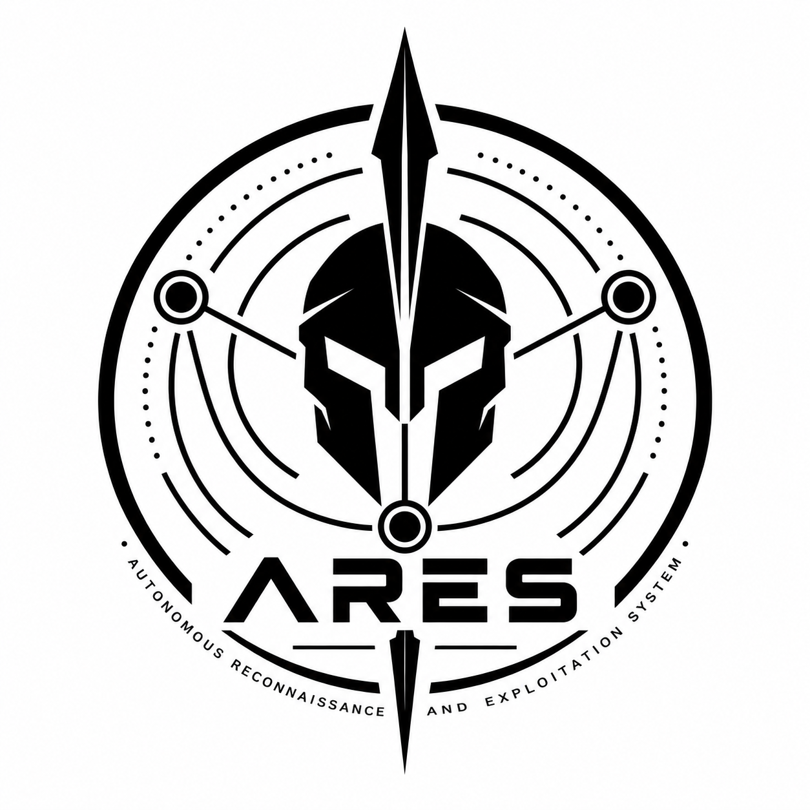
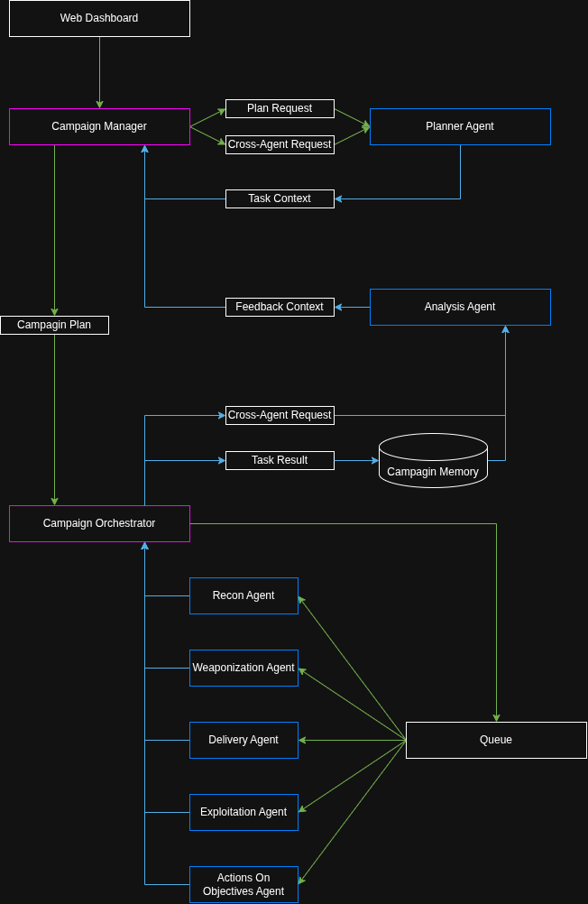

    
    <h1>Project ARES</h1>
    <h3>Autonomous Reconnaissance and Exploitation System</h3>
    <h4>An AI-powered, multi-agent offensive security framework for autonomous reconnaissance, vulnerability assessment, exploitation validation, and adversary emulation.</h4>

## Disclaimer
> [!WARNING]
> This project and all associated materials are provided **strictly for authorized red teaming and educational purposes only**.
> 
> **Unauthorized engagements using this project and associated materials are strictly prohibited**. Unauthorized access on devices using this project and associated materials may cause serious legal consequences.

## Features

Red Team Campaign Management

* Web-Based Multiplayer Operations
* Campaign Objectives & Scope Management
* Real-Time Agent Activity Monitoring
* Autonomous Campaign Planning
* Autonomous Simulation Report Generation
* Attack Path Visualization

Agent Orchestration

* Autonomous Multi-Agent Orchestration
* Autonomous Task Planning
* Autonomous Tool Selection & Execution
* Autonomous Failure Analysis & Recovery
* Autonomous Cross-Agent Collaboration

Agentic Offensive Security Features

* Reconnaissance
    * Autonomous OSINT Gathering
    * Autonomous Attack Surface Evaluation
    * Autonomous Asset Enumeration
    * Autonomous Asset Classification
    * Autonomous Asset Correlation
    * Autonomous Supply Chain Analysis
    * Autonomous Technology Fingerprinting
* Weaponization
    * Autonomous Vulnerability Analysis
    * Autonomous Exploitability Assessment
    * Autonomous MITRE ATT&CK TTP Selection
    * Autonomous Public Exploit Intelligence
    * Autonomous Exploit Compatibility Assessment
* Delivery
    * Autonomous Delivery Vector Analysis
    * Autonomous Phishing Simulation
    * Autonomous Delivery Validation
    * Autonomous Delivery Surface Discovery
* Exploitation
    * Autonomous Public Exploit Selection
    * Autonomous Exploit Validation
* Actions On Objectives
    * Autonomous Action Recommendation
    * Autonomous Objective-Based Planning
    * Autonomous Attack Path Analysis

External Resources Integration

* MITRE ATT&CK Integration
* Sliver C2 Integration
* Mythic C2 Integration
* Havoc C2 Integration
* Metasploit Integration

Plugin System

* Python AI Agent Toolkit SDK
* External Payload Storage

## System Architecture

## Contributors

## References
* [https://github.com/Hinln/ARTEX](https://github.com/Hinln/ARTEX)
* [https://github.com/jiwoochris/artex-global](https://github.com/jiwoochris/artex-global)
* [https://github.com/AIPentest/CyberStrikeAI](https://github.com/AIPentest/CyberStrikeAI)
* [https://github.com/0x4m4/hexstrike-ai](https://github.com/0x4m4/hexstrike-ai)
* [https://github.com/microsoft/ai-agents-for-beginners](https://github.com/microsoft/ai-agents-for-beginners)
* [https://github.com/strobes-security/web-pentest-sample](https://github.com/strobes-security/web-pentest-sample)
* [https://github.com/jeremylongshore/plugins-nixtla](https://github.com/jeremylongshore/plugins-nixtla)
* [https://www.lockheedmartin.com/en-us/capabilities/cyber/cyber-kill-chain.html](https://www.lockheedmartin.com/en-us/capabilities/cyber/cyber-kill-chain.html)